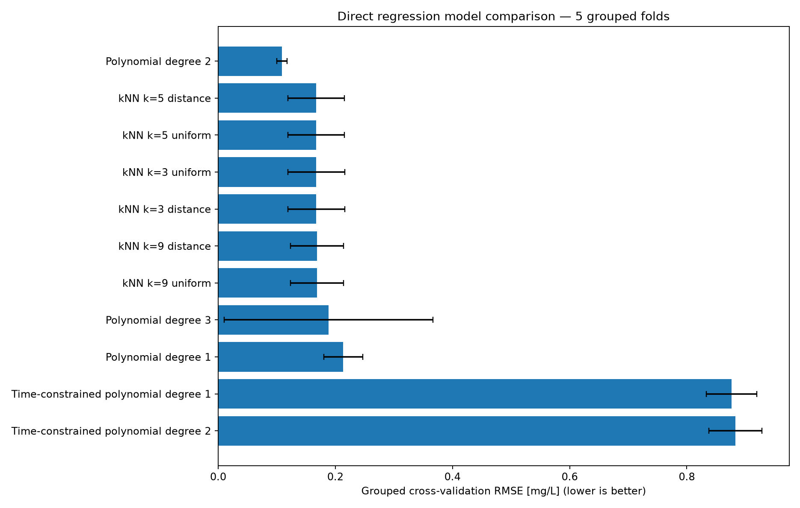
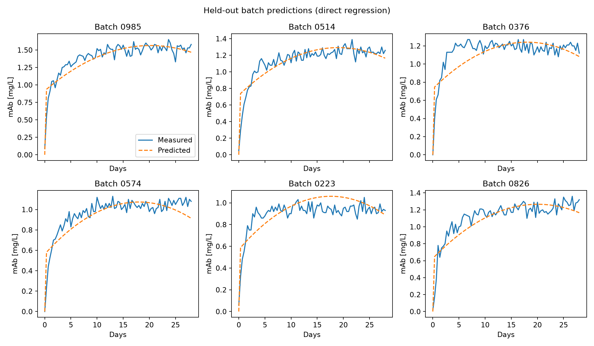
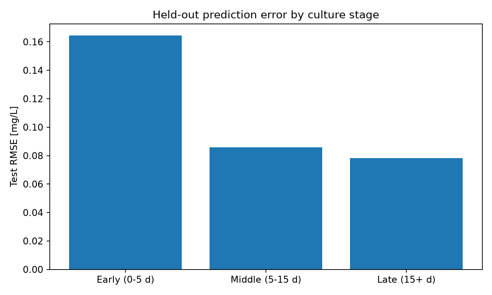
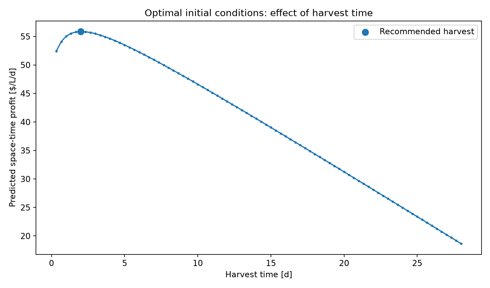

# Monoclonal Antibody Production Optimizer

This project develops and evaluates machine-learning regression models to identify profitable operating conditions for batch monoclonal antibody (mAb) production. Using simulated bioreactor measurements from 30 selected experiments, the program predicts antibody concentration from initial glucose, glutamine, viable cell density, and harvest time. Predictions are combined with material costs and a one-day turnaround period to recommend an operating strategy that maximizes space-time profit.

## Highlights

- **Selected** 30 batch experiments covering the available ranges of initial glucose, glutamine, and viable cell density.
- **Developed** standardized polynomial and k-nearest-neighbours regression pipelines for antibody concentration prediction.
- **Tested** how well models predict new experiments using five-fold cross-validation and six batches reserved for final testing.
- **Optimized** harvest time and starting conditions using a space-time profit objective.
- **Visualized** model accuracy, production trajectories, operating economics, and stage-specific prediction errors.

---
## Environment

The project uses the following libraries:

- Python: 3.10.16
- Matplotlib: 3.6.0
- NumPy: 1.26.3
- pandas: 2.0.0
- scikit-learn: 1.4.0

---
## Code Design

### Program Organization

The project separates the program entry point from its statistical and analytical components. Executing `main.py` calls the workflow in `src/functions.py`, while the `MAbRegressor` class in `src/classes.py` creates and trains the regression models provided by scikit-learn. The selected batch IDs are stored in `src/constants.py` for reference. This keeps `main.py` short and separates modeling from file handling and plotting. Input data is read from `datasets/` while results are written to `tables/` and `figures/` folders.

### Experimental Set-Up

The workflow begins by loading `initial_conditions.csv` and locating the 30 batch identifiers specified in the constants file. It checks that the requested identifiers exist and that each corresponding `batch_####.csv` file is available. Every batch file contains a time series of culture measurements. Within each batch, measurements are arranged from earliest to latest. The program also checks that no batch has two rows with the same recorded time, since repeated timestamps could mean duplicated measurements and cause data entry issues. If repeated times are found, the program stops rather than potentially using duplicated data. Each measurement is labeled with its batch ID. The initial glucose, glutamine, and viable cell density are then looked up from the initial conditions table and repeated across the rows belonging to that batch. Measurement time is converted from hours to days. This gives the model inputs known before the experiment begins, rather than using later measurements.

### Regression Inputs and Preprocessing

The prediction target is mAb concentration in mg/L. The four inputs are initial glucose concentration, initial glutamine concentration, initial viable cell density (VCD), and harvest time. All models use the same inputs. The inputs have different scales: VCD is measured in hundreds of thousands of cells/mL, while glutamine is measured in mM. Each regression pipeline therefore includes `StandardScaler`, which uses means and standard deviations learned from its training data to place features on comparable scales. Scaling happens within each training fold, so validation data do not affect the scaling values.

### Model Architectures and Training

The main polynomial pipeline uses `StandardScaler` to standardize the inputs, `PolynomialFeatures` to create squared terms and interactions, and `LinearRegression` to fit coefficients to those terms. Polynomial degrees one, two, and three are examined. Degree one provides a linear baseline, degree two introduces squared terms and pairwise interactions, and degree three increases flexibility but may overfit a small collection of independent experiments. An alternative `KNeighborsRegressor` pipeline predicts mAb from nearby standardized examples. Neighbour counts of 3, 5, and 9 are tested with both uniform and distance weighting. Two additional polynomial models were tested to see whether explicitly including the known starting condition would improve early predictions. During training, these models use the measured mAb concentration divided by elapsed culture time as the output. This represents the average antibody accumulation per day up to that measurement. At prediction time, the estimated average rate is multiplied by the selected harvest time to obtain an mAb concentration. At time zero, the predicted concentration is set to zero. Dividing by small time values can make early measurements harder to model accurately. The final prediction step also sets mAb to zero initially, as we know that no antibodies have been produced yet regardless of the experimental condition.

### Model Validation and Performance Evaluation

The experiments are divided into 24 training batches and six test batches using `GroupShuffleSplit`. Within development data, `GroupKFold` creates five validation folds. All measurements from one batch are related because they come from the same bioreactor run and share the same starting conditions. If we trained on some days from a batch and validated on other days from that same batch, the model would already have seen information about that experiment. Its validation score could therefore look unrealistically good. Keeping each complete batch either in training or in validation gives a more meaningful test of how well the model predicts an entirely new experiment. Each model configuration is trained separately for every fold, and root mean squared error (RMSE), its between-fold standard deviation, and mean coefficient of determination (R²) are recorded. The model configuration with the lowest mean validation RMSE is evaluated once on the six unseen test batches. The test trajectories are also divided into early, middle, and late stages to see whether the model performs better at certain times during production, even when its overall test score shows it performs well.

### Economic Optimization and Uncertainty

After test evaluation, the selected model is refitted using all 30 available batches. It predicts mAb concentration for combinations of initial conditions listed in the complete initial-conditions table and positive observed harvest times. The optimizer translates each concentration prediction into culture value and subtracts a starting-material cost based on glucose, glutamine, and inoculum density. Space-time profit divides this net value by harvest duration plus one day of downtime between runs. The combination with the highest predicted profit is saved as the recommended operating point. The program also derives space-time yield from predicted concentration and total cycle duration. Approximate uncertainty bounds are calculated using errors from cross-validation. In each fold, the model is trained on one set of complete batches and makes predictions for different batches that were not used to train it. The largest prediction error is recorded for each validation batch. Those errors are used to estimate how far a future mAb prediction might be from its measured value. The resulting bounds are also converted into ranges for culture value, profit, and yield. These ranges help communicate uncertainty, but they have not been verified to contain 95% of future outcomes.

### Outputs and Reproducibility

The program exports the selected experiments, train/test allocations, a model comparison table, held-out predictions, test-performance statistics, stage-level errors, and recommended operating conditions. Figures show the validation RMSE comparison, measured versus predicted test trajectories, stage-specific RMSE, and predicted profit over harvest time at the recommended starting conditions. The fixed batch IDs, repeatable train/test split, tested model configurations, and organized folders make results reproducible. Only the final recommended conditions are exported, rather than the full optimization grid.

___
## Analysis

### Experimental Design: Selecting 30 Representative Batches

The experimental design covers a wide range of starting conditions. The source dataset used to select the batches comprises seven glucose levels, seven glutamine levels, and seven viable cell density levels, with three replicate batches for each combination. Only 30 runs are used for model development. Sampling consecutive batch identifiers would risk selecting closely related initial conditions, leaving the model unable to distinguish the effects of some inputs. Instead, 30 combinations were selected from `initial_conditions.csv` to spread the experiments across low, medium, and high starting values. This type of design is referred to as *space-filling*: instead of repeatedly testing nearly identical conditions, it samples different parts of the available operating range. Its glucose values span 5 – 35 mM in 5 mM increments, its glutamine values span 1 – 7 mM in 1 mM increments, and its initial VCD values span 200,000 – 1,400,000 cells/mL in increments of 200,000. All seven levels of every input are represented, and all 30 starting-condition combinations are unique.

The selection includes low- and high-input combinations and a central combination in batch 0514 (20 mM glucose, 4 mM glutamine, 800,000 cells/mL). Additional intermediate combinations help the regression fit interactions rather than relying entirely on endpoint measurements. This coverage supports optimization across the provided range. The trade-off is limited replication: sampling distinct combinations improves coverage but leaves less information for estimating biological or simulation variability at any one operating point. Moreover, the design does not sample every possible combination, so strong interactions may remain insufficiently resolved. The full selected design is documented in [`tables/selected_batches.csv`](tables/selected_batches.csv). The inclusion of more batch data to the program is expected to improve the model accuracy, as it provides more data for the model to be trained on. 

### Model Selection and Hyperparameters

Direct regression was chosen because the operational decision involves four quantities known or chosen in advance: initial glucose, initial glutamine, initial VCD, and harvest time. Unlike recursive time-series forecasting, direct regression predicts antibody concentration at a specified time without feeding previous model predictions back into itself. This simplifies economic optimization and avoids accumulating forecast errors over a long batch. It does not explicitly simulate changing nutrient or metabolite concentrations, however, so its fitted relationships should be interpreted as empirical rather than mechanistic.

Polynomial regression provides a particularly useful balance between interpretability and nonlinearity. The general degree-two relationship is shown below; the symbols represent standardized starting conditions and harvest time.

/img_2.png)

A degree-two polynomial includes the four standardized input terms, their squares, and pairwise interactions, allowing the effect of one input to depend on another. `PolynomialFeatures(degree=2, include_bias=False)` creates these terms, and `LinearRegression` estimates their coefficients. The intercept is provided by the regressor rather than being duplicated in the feature transformer. Degree-one and degree-three models establish whether a simpler or more flexible functional form is preferable. k-nearest-neighbours regression provides an alternative without a global polynomial equation. The neighbour counts 3, 5, and 9 test the trade-off between following local patterns and smoothing over neighbouring samples. Uniform and inverse-distance weighting test whether closer observations deserve more influence. All comparisons use the same five-fold batch-grouped validation design.

The resulting mean cross-validation RMSE for degree-two polynomial regression was **0.1089 ± 0.0087 mg/L**, with mean R² **0.8964**. The strongest k-NN alternative, **k = 5 with distance weighting**, achieved RMSE **0.1675 ± 0.0481 mg/L**, with mean R² **0.7614**. Degree one performed worse (RMSE **0.2136 mg/L**), consistent with underfitting nonlinear production dynamics. Degree three also performed worse (RMSE **0.1885 mg/L**) and showed much greater fold-to-fold variation (**0.1784 mg/L** standard deviation), suggesting an unstable fit. Exploratory time-constrained polynomials that modeled mAb/time performed poorly (RMSE approximately **0.88 mg/L**), possibly because dividing by small time values magnifies early-time variability. The degree-two polynomial therefore offered the most convincing balance of accuracy, stability, and model complexity. The results are in [`tables/model_comparison.csv`](tables/model_comparison.csv).

### Generalization and Predictions Over Culture Time

The best-performing model was evaluated on six complete batches excluded from model development. Its held-out RMSE was **0.101 mg/L**, and its R² was **0.844**. Its positive R² indicates improvement over predicting a constant mean mAb concentration. Most measured trajectories increase rapidly and then approach a plateau. The fitted degree-two polynomial reproduces the broad rise and plateau reasonably well but is noticeably smoother than the measured signal. The prediction plots for batches 0985, 0514, 0376, 0574, 0223, and 0826 are especially useful for inspecting between-batch differences.

A known boundary condition is that mAb concentration equals zero at the start of a batch. The initial version of the direct polynomial produced nonzero predictions at time zero. A post-prediction correction was therefore introduced so that time-zero output is exactly zero. This improved the reported held-out RMSE from **0.124 to 0.101 mg/L**, but it should not be mistaken for a complete solution to early-time bias. Immediately after time zero, the polynomial can still predict an abrupt increase because the fitted function itself is unchanged. This matters when optimizing short harvest durations.

Stage-specific errors highlight this limitation: held-out RMSE was **0.1644 mg/L during days 0–5 (90 observations)**, compared with **0.0859 mg/L for days 5–15 (180 observations)** and **0.0781 mg/L after day 15 (240 observations)**. Early-time error is about twice the late-time error. Consequently, the selected harvest time warrants more caution than the overall model score alone might suggest. These diagnostics can be examined in [`tables/test_stage_errors.csv`](tables/test_stage_errors.csv), [`figures/test_stage_errors.png`](figures/test_stage_errors.png) (shown below), and the held-out trajectory plot (above).

### The Effect of Initial Conditions on Yield and Profitability

The regression predicts mAb concentration using the three starting conditions and the selected harvest time. The economic calculations also consider how much it costs to prepare the culture. Higher starting glucose, glutamine, and VCD increase the specified cost, so the model must consider both mAb production and the expense of achieving it. The cost is calculated using the following equation:

/img_4.png)

Here, initial glucose and glutamine are measured in mM and initial VCD is measured in cells/mL. Cell culture cost is reported in $/L. The predicted mAb concentration is converted into a monetary value using the following equation:

/img_5.png)

The value minus the initial culture cost gives the profit per liter:

/img_6.png)

To compare harvest times fairly, the total profit is divided by the time needed to complete one batch, including the required one day of downtime between batches:

/img_7.png)

The amount of mAb produced per liter per day is calculated separately as space-time yield:

/img_8.png)

The added day in the last two equations represents the turnaround between batches. These equations show why maximizing antibody concentration alone is not a strong approach. Raising initial glucose, glutamine, or VCD always increases the specified direct culture cost, but whether that increase improves mAb production depends on the fitted response surface. It becomes economically worthwhile only if the additional predicted product value compensates for the additional cost and cycle duration. A condition could therefore deliver high mAb space-time yield while providing lower profit because its initial materials are expensive. Conversely, a lower yield run could be preferred if it requires substantially less input material. The degree-two model can learn interactions between the inputs, meaning the predicted effect of one starting condition may depend on the others. However, the exported figures do not directly show how much each individual input contributes to profit, so we should not claim that a particular nutrient caused the observed trends without further analysis. Such interpretations would require further response-surface analyses or controlled experimental comparisons.

### Recommended Operating Conditions and Economic Forecast

The optimization evaluates the unique starting-condition combinations provided in `initial_conditions.csv` over the positive observed harvest times, then selects the combination with the largest predicted space-time profit. In the current run, the model recommended harvesting at **2.00 days**, with estimated space-time profit **$55.86 / (L*d)**. The predicted profit-versus-time curve at the selected starting conditions peaks early and decreases at longer durations. This trend is plausible for an economic metric that divides net batch value by total cycle length, but it also overlaps the early-time region where predictive error is highest. The recommendation should therefore be treated as a model-supported operating hypothesis, not a confirmed experimental optimum.

The complete numerical recommendation is exported to [`tables/recommended_conditions.csv`](tables/recommended_conditions.csv). Predictions at the selected operating point are summarized below. The ranges are **approximate error-derived prediction bounds**, not validated 95% coverage intervals.

| Output | Recommended Estimate | Approximate Lower - Upper Bounds |
|---|:---:|:---:|
| Initial glucose concentration [mM] | **20** | — |
| Initial glutamine concentration [mM] | **3** | — |
| Initial VCD [cells/mL] | **600,000** | — |
| Harvest time [d] | **2.00** | — |
| Predicted mAb at harvest [mg/L] | **0.7276** | **0.0487 – 1.4064** |
| Cell culture cost [$/L] | **560.00** | Fixed by the specified starting conditions |
| Cell culture value at harvest [$/L] | **727.59** | **48.74 – 1,406.44** |
| Space-time profit [$/ (L·d)] | **55.86** | **-170.42 – 282.15** |
| mAb space-time yield [mg/(L·d)] | **0.2425** | **0.0162 – 0.4688** |

Substituting the recommended starting conditions into the cell culture cost equation gives a total cost of \$560/L, consisting of \$200/L from glucose, \$60/L from glutamine, and \$300/L from the initial viable cell density (VCD). The predicted cell culture value of \$727.59/L results in a net profit of \$167.59/L. Dividing this profit by the three-day production cycle (two days of cultivation plus one day of downtime) gives a maximum predicted space-time profit of **$55.86/(L*d)**.

However, the negative lower bound of the estimated profit interval indicates that financial losses are still possible due to uncertainty in the model's predictions. Therefore, while the recommended conditions maximize the predicted space-time profit, they do not guarantee that the process will be profitable in future production runs.

### Uncertainty, Limitations, and Recommendations

The code estimates uncertainty from prediction errors observed during cross-validation, while keeping entire batches together. For the chosen conditions, the concentration interval is especially wide (0.0487 – 1.4064 mg/L), which becomes a space-time profit range of −\$170.42 to $282.15/(L*d). For each validation batch that the model did not train on, the program compares predicted and measured mAb concentration at every recorded time point. It keeps the largest absolute difference for that batch, then calculates the approximate 95th percentile of those batch-level errors. That value is used as the amount added to and subtracted from the predicted mAb concentration. That half-width is applied to the optimized mAb prediction; concentration limits are then transformed into intervals for value, profit, and yield using the deterministic economics. The resulting limits show how large errors were across batches not used to fit each cross-validation model, but **they have not been demonstrated to achieve 95% predictive coverage**. In particular, there are few independent batches, the optimal operating point is chosen using the same model, and the selected condition may differ from the conditions where errors were assessed. These are approximate bounds—not statistically guaranteed 95% prediction intervals. Their limitations should be retained when interpreting or reporting the results.

Further limitations include incomplete coverage of the three-dimensional experimental grid, limited direct replication, smooth polynomial behavior that may miss abrupt biological transitions, and the fact that the model does not directly incorporate changing glucose, glutamine, lactate, ammonia, or cell viability after inoculation. k-NN supplies a useful nonlinear comparator but also depends strongly on coverage of the feature space. The largest opportunity for improvement is validation near the recommended early harvest time: additional distinct batches or targeted replicates near the predicted optimum could determine whether the early profit peak is robust. Because experiments are limited, such targeted coverage would need to be balanced against broader exploration. Within the current dataset, stage-specific error analysis, transparent reporting of approximate uncertainty, and preservation of the untouched test evaluation provide a defensible basis for interpreting the recommendation without overstating accuracy.
